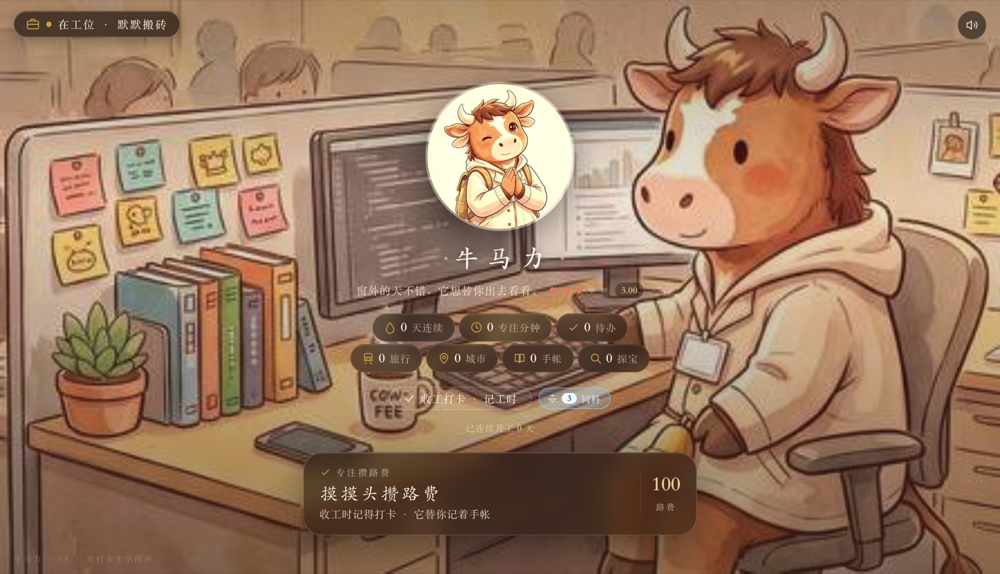

# dsh-pet-niumali · 牛马力

DSH 界面里的常驻桌宠。右下角浮着一只小牛，点开是「牛马力 · 替你活」——
一套双打卡生活闭环：开工 / 收工打卡、专注计时、待办、手帐、旅行、探宝。



## 它做了什么

- **常驻浮球**：注册在 DSH 的 `shell.overlay` 插槽上，浮在整个界面之上，可拖动、可收起，位置与展开状态记录在 `localStorage`。
- **浮窗内是完整页面**：展开后用一个 iframe 载入插件自己的 `/pet-niumali/` 页面。首次展开才挂载，之后收起只是隐藏 —— 所以专注计时不会被打断。
- **徽标显示路费**：浮球上的小徽标实时读同一份存档，显示当前路费；当天开工与收工都打过卡时变成 `✓`，外圈转绿。
- **设置页一栏**：在设置的 `settings.section` 插槽里加一栏「牛马力桌宠」，用来开关浮球与单独打开页面。
- **一条静态资源路由**：`/pet-niumali/`，直接访问就是完整页面（也可以在新标签页里打开）。

插件不带后端、不发起网络请求、不读文件、不执行命令；全部存档都在浏览器 `localStorage` 的 `niumali.v9` 键下。

## 安装

### 从 DSH 插件市场（推荐）

在 DSH 的插件市场里搜索「牛马力 / dsh-pet-niumali」安装即可，装完重启 DSH。

### 手动安装

在你所用 profile 的 `package.json` 里加一条依赖，并把包名加进 `dsh.profile.bundles`：

```jsonc
// ~/.dsh/profiles/desktop/package.json
{
  "dependencies": {
    "dsh-pet-niumali": "github:chenyuan1251/dsh-pet-niumali#main"
  },
  "dsh": {
    "profile": {
      "bundles": [
        "dsh-pet-niumali"
      ]
    }
  }
}
```

然后在同一目录 `pnpm install`，重启 DSH。

> 从源码/Git 安装时，DSH 可能提示一次构建授权；这是下载整仓源码的常规行为。

## 独立桌面宠物（可选，不需要 DSH）

想不打开 DSH 也能看见它：

```bash
cd dsh-pet-niumali
npm install
npm start          # 等价于 npx electron electron/main.mjs
```

会开一个 420×720 的透明、无边框、置顶小窗。鼠标移到顶部会浮出拖动 / 置顶 / 最小化 / 关闭控制条。
这条路径与 DSH 里的浮球互不影响，两者各自用各自的 `localStorage`。

## 目录结构

```
dsh-pet-niumali/
├── package.json              # 插件元数据（dsh.bundle / dsh.client）
├── cordis.patch.yml          # 把本插件挂进插件树
├── index.mjs                 # 服务端半边：注册 /pet-niumali/ 静态资源路由
├── client.js                 # 客户端半边：shell.overlay 浮球 + settings.section
├── web/                      # 页面本体
│   ├── index.html
│   ├── desktop-pet-bridge.js # 在 Electron 小窗里显示标题与拖拽控制
│   └── assets/               # 样式、脚本与图片
├── electron/
│   ├── main.mjs              # Electron 主进程
│   └── preload.mjs           # contextBridge 暴露的最小 API
├── assets/screenshots/       # 市场截图
└── README.md
```

## 已知限制

- 图片资源约 7 MB，首次打开那一页会慢一点；之后走强缓存。
- 页面按竖版布局设计，浮窗宽度固定 400px、高度在 420–660px 之间自适应。
- 存档在 `localStorage`，所以「浏览器里」和「Electron 独立窗口里」是两份互不相通的数据。

## License

MIT